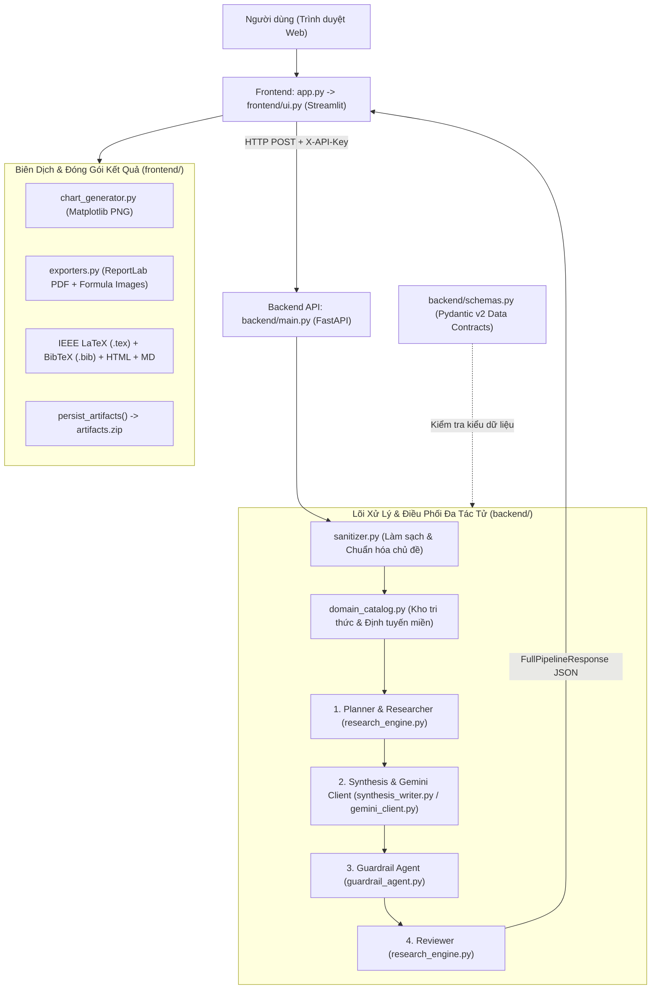
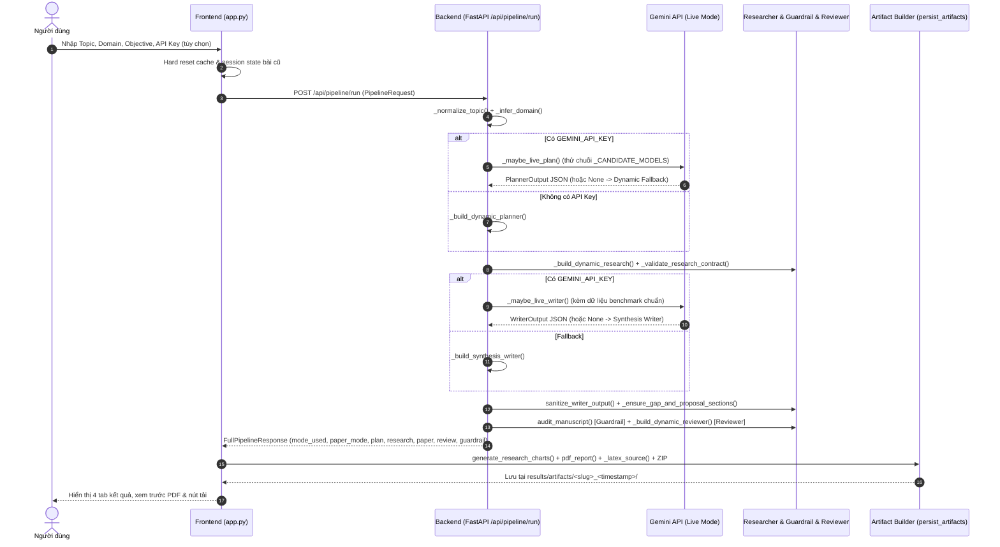

# Báo Cáo Tổng Quan Dự Án: Smart Research Lab (Hệ Thống Viết Bài Báo Khoa Học Tự Động)

> **Môn học:** Hệ thống thông minh — Khoa Công nghệ Thông tin, Học viện Công nghệ Bưu chính Viễn thông (PTIT)  
> **Giảng viên hướng dẫn:** Thầy Hoàng Mạnh Cường  
> **Sinh viên thực hiện:** Trần Văn Đức (`B23DCCN191`)  
> **Repository:** `AI-automatically-writes-scientific-papers`

---

## 1. Khái Quát Chung Về Dự Án

### 1.1. Bài toán & Mục tiêu
Việc viết một bài báo khoa học hoàn chỉnh đòi hỏi nhiều bước liên kết chặt chẽ: xác định khoảng trống nghiên cứu (*Research Gap*), đặt giả thuyết, lựa chọn bộ dữ liệu và mô hình đối chứng (*Baselines*), thiết kế ma trận thực nghiệm & thử nghiệm cắt bỏ thành phần (*Ablation Study*), trình bày công thức toán học, biên soạn bản thảo chuẩn học thuật (IEEE/IMRAD) và tự phản biện.

**Smart Research Lab** được xây dựng nhằm tự động hóa quy trình lập kế hoạch, thiết kế thực nghiệm mô phỏng, biên soạn bản thảo và kiểm toán chất lượng bài báo khoa học chỉ từ một chủ đề đầu vào tự do (tiếng Anh, tiếng Việt hoặc hỗn hợp).

### 1.2. Tính năng cốt lõi
- **Chuẩn hóa & Làm sạch đầu vào (`backend/sanitizer.py`):** Hỗ trợ chủ đề ngắn, tiếng Việt, song ngữ; loại bỏ ký tự điều khiển/XML/LaTeX nguy hiểm để chống prompt/LaTeX injection; tự động chuyển một số cụm thuật ngữ Việt → Anh và mở rộng chủ đề quá ngắn (< 3 từ).
- **Định tuyến tri thức theo miền (`Knowledge Base & Inference Engine`):** Nhận diện lĩnh vực nghiên cứu bằng so khớp ranh giới từ khóa (*token-boundary matching*), chọn sẵn tập dữ liệu chuẩn, chỉ số đánh giá chính (*Primary Metric*) và các mô hình baseline/proposed phù hợp.
- **Điều phối Đa tác tử 5 giai đoạn (`Planner → Researcher → Writer → Guardrail → Reviewer`):** Tách bạch vai trò từng Agent thông qua hợp đồng dữ liệu chặt chẽ bằng Pydantic v2 (`backend/schemas.py`).
- **2 Chế độ vận hành linh hoạt (`Live Gemini` & `Dynamic Fallback`):**
  - Khi có `GEMINI_API_KEY` / `GOOGLE_API_KEY`: Gọi Google Gemini để lập kế hoạch và viết bản thảo đầy đủ (kèm cơ chế tự động chuyển model dự phòng khi quá tải/hết quota).
  - Khi không có API key hoặc API gặp sự cố: Tự động chạy `Dynamic Fallback` xác định (*deterministic*) giúp hệ thống vẫn sinh được bài báo đầy đủ cấu trúc, công thức, biểu đồ và file PDF/LaTeX hoàn chỉnh.
- **So sánh với PDF bài báo gốc (`Baseline Paper Comparison`):** Cho phép người dùng tải lên file PDF bài báo mẫu (giới hạn 20 MB, tối đa 15 trang, 300.000 ký tự), trích xuất metadata (model, dataset, metric, hạn chế) có kèm câu trích dẫn kiểm chứng và tạo nhận xét đối chiếu trực tiếp với bài mới sinh.
- **Kiểm toán học thuật & Nhãn bằng chứng (`Guardrail Agent` & `Evidence Labels`):** Không đánh đồng số liệu ước lượng với số liệu đo thật. Mọi bảng biểu đều gắn nhãn rõ ràng (*Controlled Simulation*, *Literature Baseline / Planned*, *Measured*, *Planned / Unverified*) và kiểm tra cân bằng ngoặc LaTeX, độ trễ/FLOPs bất thường.
- **Xuất đa định dạng & Hỏi đáp bài báo:** Tự động sinh `paper.pdf` (ReportLab + công thức Matplotlib), `paper_ieee.html` (bố cục 2 cột IEEE), `paper.tex`, `references.bib`, `paper.md`, `benchmark_matrix.json`, `guardrail_report.json`, các biểu đồ PNG và đóng gói toàn bộ thành `research_artifacts.zip`; tích hợp tính năng hỏi đáp trực tiếp trên nội dung bài báo (`/api/paper/ask`).

---

## 2. Kiến Trúc Tổng Thể Hệ Thống

Hệ thống được tổ chức theo kiến trúc **Client–Server phân lớp**, tách biệt giao diện người dùng (Streamlit), lõi điều phối đa tác tử (FastAPI) và các module phụ trợ độc lập.

### Cấu trúc thư mục chính trong dự án (Kiến trúc Web thuần)

| Đường dẫn | Vai trò |
|---|---|
| `app.py` | Điểm vào mỏng khởi chạy ứng dụng Web Streamlit (`frontend/ui.py`). |
| `frontend/ui.py` | Điều phối sidebar nhập liệu, quản lý API key/model, hard-reset session và điều hướng 4 tab. |
| `frontend/views.py` | Hiển thị thông tin kế hoạch, biểu đồ Plotly, PDF preview dạng ảnh, chatbot Q&A và phản biện. |
| `frontend/exporters.py` | Biên dịch `paper.pdf` (ReportLab + Matplotlib), IEEE HTML, LaTeX, BibTeX, Markdown và đóng gói `artifacts.zip`. |
| `frontend/baseline_comparison.py` | Đọc PDF bài gốc (giới hạn 20 MB / 15 trang), trích xuất metadata và tạo nhận xét đối chiếu có câu dẫn. |
| `frontend/chart_generator.py` | Sinh các biểu đồ PNG (`benchmark_efficiency.png`, `ablation_tradeoff.png`) bằng Matplotlib. |
| `frontend/api_client.py`, `frontend/styles.py` | Giao tiếp HTTP tới FastAPI (`/api/pipeline/run`, `/api/paper/ask`) và cấu hình CSS/Preset/nhãn bảng. |
| `backend/main.py` | FastAPI server: middleware bảo mật/rate limit và điều phối toàn bộ pipeline API. |
| `backend/schemas.py` | Khai báo các schema Pydantic v2 (`PipelineRequest`, `PlannerOutput`, `ResearcherOutput`, `WriterOutput`, `GuardrailOutput`, `ReviewerOutput`, `FullPipelineResponse`). |
| `backend/sanitizer.py` | Chuẩn hóa Unicode NFKC, làm sạch chủ đề/LaTeX/Markdown và loại bỏ placeholder chưa sinh. |
| `backend/domain_catalog.py` | Hồ sơ các miền nghiên cứu, từ khóa định tuyến, bộ dữ liệu chuẩn và catalog mô hình. |
| `backend/research_engine.py` | Planner, Researcher (benchmark, curves, ablation mô phỏng có kiểm soát) và Reviewer. |
| `backend/synthesis_writer.py` | Writer dự phòng (Synthesis Fallback), lọc trùng lặp câu văn và chuẩn hóa cấu trúc Gap/Proposal. |
| `backend/gemini_client.py` | Kết nối Gemini API, tự động chuyển model dự phòng, phục hồi JSON và trả lời hỏi đáp bài báo. |
| `backend/guardrail_agent.py` | Kiểm toán công thức toán học (ngoặc `{}`/`[]`, ký hiệu chữ), cảnh báo latency/FLOPs vượt > 1.5x và chuẩn hóa nhãn bằng chứng. |
| `data/` | Kho dữ liệu địa phương xác thực tùy chọn (`huggingface/ag_news`, script `prepare_hf_text.py`). |
| `results/artifacts/` | Thư mục lưu kết quả từng lần chạy theo timestamp và UUID. |
| `tests/` | Gồm `test_pipeline_stress.py`, `test_adversarial_topics.py` và `test_e2e_app.py`. |

---

## 3. Luồng Hoạt Động Chi Tiết (End-to-End Pipeline Flow)

Khi người dùng nhấn **🚀 Bắt đầu sinh bài báo** trên giao diện `app.py`, hệ thống thực hiện tuần tự luồng xử lý sau:

### Phân tích từng giai đoạn trong luồng xử lý

#### Giai đoạn 1: Làm sạch & Khởi tạo yêu cầu (`app.py` → `backend/main.py`)
1. `app.py` đọc API key ưu tiên từ ô nhập trên sidebar, sau đó đến `.env` / biến môi trường (`GEMINI_API_KEY`, `GOOGLE_API_KEY`). Trước khi chạy mới, frontend xóa sạch cache và `session_state` của bài báo cũ để tránh lẫn dữ liệu.
2. Backend nhận `PipelineRequest` tại `POST /api/pipeline/run`, đi qua middleware `protect_api` (kiểm tra loopback hoặc `X-API-Key` nếu cấu hình `SMART_RESEARCH_API_KEY`, đồng thời áp dụng Rate Limit mặc định `10 requests/phút/IP`).
3. `_normalize_topic()` gọi `sanitize_academic_topic()` làm sạch chuỗi đầu vào. Nếu bật `require_verified_data=True`, `_validate_verified_request()` sẽ kiểm tra sự tồn tại của tập dữ liệu thật trong thư mục `data/`.

#### Giai đoạn 2: Knowledge Base & Inference Engine (`_topic_profile`, `_knowledge_layer`)
- Backend đối chiếu chủ đề + domain + objective với bảng hồ sơ miền `_DOMAIN_PROFILES` (bao gồm các miền như *Multimodal & Vision-Language*, *Recommendation Systems & CTR*, *Graph Learning & FinTech*, *NLP / RAG*, *NLP / Machine Translation*, *Computer Vision*, *Reinforcement Learning*, *Time Series Forecasting*, *Healthcare AI*, *Quantum Computing*, *Legal AI*, *Maritime Logistics*, *General Deep Learning & Applied AI*...).
- Sử dụng **Token-boundary matching** cho từ viết tắt kỹ thuật ngắn (`asr`, `rag`, `llm`, `clip`, `vqa`, `ctr`, `ppo`, ...) để tránh khớp nhầm chuỗi con.
- Tính điểm tin cậy định tuyến (`routing_confidence` trong khoảng `0.62` – `0.99`) và gán metadata kiến trúc (`knowledge_base`, `inference_engine`, `agent_coordination`).

#### Giai đoạn 3: Planner Agent (`_maybe_live_plan` / `_build_dynamic_planner`)
- **Đầu ra (`PlannerOutput`):** Tiêu đề nghiên cứu, domain, câu hỏi nghiên cứu (*Research Question*), giả thuyết cốt lõi (*Hypothesis*), danh mục bộ dữ liệu (`datasets_catalog`), danh mục mô hình (`models_catalog` gồm ít nhất 2 `Baseline` và 1 `Proposed` với thông số `params_m`, `flops_g`, `latency_ms`), phương pháp đề xuất, chỉ số đánh giá và kế hoạch thực nghiệm.
- `_ensure_system_intelligence()` kiểm tra bắt buộc kế hoạch phải có đủ cả vai trò `Baseline` và `Proposed` trước khi sang bước sau.

#### Giai đoạn 4: Researcher Agent (`_build_dynamic_research`)
- Sinh dữ liệu thực nghiệm mô phỏng có kiểm soát (*Controlled Planning Simulation Estimate*) sử dụng seed xác định theo hàm băm SHA-256 của tiêu đề (`np.random.default_rng(seed)`) để đảm bảo cùng một chủ đề sẽ cho kết quả nhất quán khi demo:
  - **Đường cong huấn luyện (`training_curves`):** 15 epoch cho **từng tập dữ liệu** trong `datasets_catalog` (gồm `baseline_loss`, `proposed_loss`, `baseline_score`, `proposed_score`).
  - **Ma trận đối chứng (`benchmark_table`):** So sánh mô hình đề xuất với các baseline trên tập dữ liệu chính (`dataset_names[0]`) gồm `primary_metric`, `secondary_metric`, `latency_ms`, `params_m`, `vram_mb`, `flops_g` và nhãn `evidence_type` (`Controlled Simulation` cho mô hình đề xuất, `Literature Baseline / Planned` cho baseline).
  - **Nghiên cứu loại bỏ thành phần (`ablation_study`):** Gồm cấu hình đầy đủ (`Full proposed model`) và 3 cấu hình lần lượt bỏ các thành phần cốt lõi theo miền nghiên cứu.
  - **Đánh giá logic nội bộ:** Tính `reasoning_consistency_score` và `knowledge_retrieval_precision`, kiểm tra hợp đồng dữ liệu bằng `_validate_research_contract()`.

#### Giai đoạn 5: Writer Agent (`_maybe_live_writer` / `_build_synthesis_writer`)
- **Live Gemini Writer:** Sử dụng `MASTER_RESEARCH_WRITER_PROMPT` (yêu cầu văn phong học thuật chuẩn ICLR/NeurIPS/IEEE, độ dài mục tiêu 3.800–4.800 từ, chia tiểu mục `### X.Y ...`, bám sát số liệu của `ResearcherOutput` và không được phép tự nâng nhãn mô phỏng thành `Measured`).
- **Hợp nhất & Hậu xử lý (`sanitize_writer_output` + `_ensure_gap_and_proposal_sections`):**
  - Nếu bản trả về từ Gemini thiếu trường nào, tự động bù từ `_build_synthesis_writer` hoặc phục hồi JSON cắt cụt qua `_safe_repair_truncated_json()`.
  - Chuẩn hóa heading Markdown (`### X.Y`), tháo code block bọc công thức toán, lọc trùng lặp câu văn, đảm bảo luôn có mục **Research Gap** & **Proposed Method**, tóm tắt chuẩn 1 đoạn cho `abstract`, và giới hạn tối đa **4 công thức toán học cốt lõi** (`mathematical_formulas[:4]`).

#### Giai đoạn 6: Guardrail Agent & Reviewer Agent
- **Guardrail (`audit_manuscript` trong `backend/guardrail_agent.py`):**
  - Kiểm tra công thức LaTeX có bị lệch cặp ngoặc `{}` / `[]` hoặc thiếu ký tự biến số hay không.
  - Kiểm tra trong `benchmark_table`: nếu `latency_ms` hoặc `flops_g` của mô hình đề xuất lớn hơn `1.5x` so với baseline tốt nhất thì gắn cảnh báo `"needs_review"`.
  - Chuẩn hóa toàn bộ `evidence_type` và thống kê `GuardrailOutput`.
- **Reviewer (`_build_dynamic_reviewer`):**
  - Chấm điểm `novelty_score`, `rigor_score`, `clarity_score`, `overall_score` (thang 10), đưa ra `verdict` (`ACCEPT`, `MINOR_REVISION`, `MAJOR_REVISION`, `REJECT`), liệt kê điểm mạnh, điểm yếu và gợi ý chỉnh sửa.

#### Giai đoạn 7: Đóng gói & Trình bày (`app.py`)
- `persist_artifacts()` gọi `generate_research_charts()` vẽ biểu đồ PNG, gọi `pdf_report()` (ReportLab + công thức render bằng Matplotlib để đảm bảo hiển thị sắc nét) biên dịch file `paper.pdf`, đồng thời sinh `paper_ieee.html`, `paper.tex`, `references.bib`, `paper.md`, `benchmark_matrix.json`, `guardrail_report.json` và nén thành `artifacts.zip`.
- Render trang PDF sang ảnh bằng `PyMuPDF` (`_render_pdf_preview_pages`, xem trước tối đa 3 trang đầu trực tiếp trên trình duyệt) để tránh lỗi chặn iframe của trình duyệt, kèm nút mở PDF ở tab mới qua Blob URL.

---

## 4. Cơ Chế Live Gemini & Dynamic Fallback

Đây là một trong những điểm mạnh về độ ổn định (*resilience*) của hệ thống khi trình diễn:

1. **Danh sách model ưu tiên & dự phòng (`_CANDIDATE_MODELS`):**
   - `gemini-3.8-flash` → `gemini-3.6-flash` → `gemini-3.7-flash` → `gemini-3.5-flash` → `gemini-3.5-flash-lite` → `gemini-3.1-flash-lite`.
   - Người dùng có thể chọn model ưu tiên trên giao diện Streamlit (`st.session_state["gemini_model"]`).
2. **Xử lý lỗi thông minh trong `_safe_live_call()`:**
   - Timeout linh hoạt (`45s` cho Planner `max_tokens <= 8192`, `110s` cho Writer `max_tokens = 32768`).
   - Nếu model trả về lỗi `404 / NOT_FOUND` hoặc `429 / RESOURCE_EXHAUSTED`, model đó được đưa vào `_EXHAUSTED_MODELS` để bỏ qua ở các lượt gọi tiếp theo (và được reset khi người dùng đổi API key mới). Các lỗi tạm thời (`503/504`) vẫn giữ model đó trong danh sách thử lại.
3. **Phân tách trạng thái (`mode_used` và `paper_mode`):**
   - Nếu cả Planner và Writer đều chạy thành công qua Gemini: `mode_used = "live_gemini"`, `paper_mode = "live_gemini"`.
   - Nếu Planner thành công nhưng Writer lỗi JSON/timeout: hệ thống vẫn giữ kế hoạch từ Gemini và dùng Synthesis Writer dự phòng (`mode_used = "live_gemini"`, `paper_mode = "dynamic_fallback"`), đồng thời hiển thị cảnh báo rõ trên UI.
   - Nếu không có API Key: chạy hoàn toàn bằng `dynamic_fallback` chỉ trong vài giây.

---

## 5. Giao Diện Người Dùng & Các Chức Năng Chính

Giao diện `app.py` gồm **Sidebar điều khiển** và **4 Tab nội dung chính**:

### Sidebar (Bảng điều khiển nghiên cứu)
- Nhập **Gemini API Key** (hoặc tự động đọc từ `.env`) và chọn **Gemini Model**.
- Chọn **5 Chủ đề mẫu có sẵn (Presets)** thuộc các lĩnh vực NLP/Efficiency, Computer Vision, Multimodal (CLIP), Graph Learning/FinTech, Healthcare AI, hoặc nhập **Custom Topic** bất kỳ.
- **Baseline Paper Comparison:** Tải lên file PDF bài báo gốc, bấm *Extract baseline metadata* (dùng LLM hoặc rule-based trích xuất model, dataset, metric, hạn chế kèm câu trích dẫn nguồn), chỉnh sửa/lưu metadata và đối chiếu trực tiếp với bài báo mới sinh.

### 4 Tab hiển thị kết quả
1. **⚙️ Cấu hình chủ đề:**
   - Hiển thị *Research Question*, *Core Hypothesis*, kiến trúc *Knowledge Base / Inference Engine / Multi-Agent Coordination*.
   - Thẻ thông tin các tập dữ liệu (`Datasets Catalog`), bảng thông số mô hình đề xuất & biểu đồ `Parameters vs Latency`.
   - Luồng kiến trúc phương pháp đề xuất (`render_method`), công thức toán học LaTeX, đoạn mã PyTorch minh họa (`TaskAwareBlock`), bảng kiểm tra dữ liệu địa phương đã xác thực (`render_verified_datasets`).
   - Kết quả phản biện tự động (`render_review`) hoặc bảng **So sánh trực tiếp với PDF bài gốc** kèm nhận xét Điểm mạnh / Hạn chế / Đề xuất cải tiến có câu dẫn kiểm chứng (`render_direct_baseline_comparison`).
2. **📄 Xem trước bản thảo:**
   - Nút tải `research_paper.pdf`, mở PDF trong tab mới, tải `research_artifacts.zip`.
   - Xem trước trực tiếp các trang PDF dưới dạng ảnh độ phân giải cao.
   - **💬 Hỏi về bài báo:** Chatbot hỏi đáp trực tiếp trên nội dung bài báo vừa sinh (có 4 câu hỏi gợi ý nhanh + lịch sử hội thoại).
3. **📊 So sánh & biểu đồ:**
   - Hai biểu đồ đường `Validation Loss` và `Primary Metric` theo 15 epoch hiển thị **tất cả các tập dữ liệu** trên cùng đồ thị để đối chiếu trực quan.
   - Bảng và 3 biểu đồ cột so sánh mô hình nội bộ (`Primary metric`, `Latency (ms)`, `Parameters (M)`).
   - Bảng và biểu đồ **Thử nghiệm loại bỏ từng thành phần (`Ablation Study`)** cùng danh sách các phát hiện chính (*Key Findings*).
4. **📦 Tệp kết quả:**
   - Cung cấp 8 nút tải riêng biệt: `research_paper.pdf`, `paper_ieee.html`, `paper.tex`, `references.bib`, `paper.md`, `benchmark_matrix.json`, `guardrail_report.json`, và `research_artifacts.zip`.

---

## 6. Công Nghệ Sử Dụng & Kiểm Thử

### Stack công nghệ (`requirements.txt`)
- **Backend & Validation:** `FastAPI`, `Uvicorn`, `Pydantic v2`, `python-dotenv`, `Requests`.
- **LLM Integration:** `google-genai` (Google Gemini SDK).
- **Frontend & Trực quan hóa:** `Streamlit`, `Plotly`, `Pandas`, `NumPy`, `Tabulate`.
- **Xử lý PDF & Xuất bản:** `ReportLab` (tạo PDF), `PyMuPDF` (`fitz` — đọc PDF baseline & render ảnh trang xem trước), `Matplotlib` (vẽ biểu đồ & render công thức toán).

### Kiểm thử & Đảm bảo chất lượng
Hệ thống có các kịch bản kiểm thử tự động trong mã nguồn:
- Kiểm tra cú pháp Python (`python -m py_compile app.py backend/*.py frontend/*.py tests/*.py`).
- `tests/test_pipeline_stress.py`: Kiểm thử pipeline đầu cuối với 5 chủ đề thuộc các lĩnh vực khác nhau và xác minh tạo đầy đủ artifacts.
- `tests/test_adversarial_topics.py`: Kiểm thử 10 chủ đề đặc biệt (quá ngắn, tiếng Việt, song ngữ, ký tự LaTeX/XML, ký tự đặc biệt, miền lạ).
- `tests/test_e2e_app.py`: Kiểm thử luồng giao diện người dùng hoàn chỉnh bằng Playwright.

---

## 7. Hạn Chế Hiện Tại & Hướng Phát Triển

### Hạn chế cần lưu ý khi báo cáo
1. **Số liệu mặc định là mô phỏng lập kế hoạch:** Trừ khi kết nối với worker chạy thực nghiệm bên ngoài trên tập dữ liệu thực tế, các giá trị latency, VRAM, loss/metric curve hiện tại là *Controlled Planning Simulation Estimates*.
2. **Giới hạn kích thước PDF đối chứng:** Tải lên PDF bài gốc giới hạn ở 20 MB và đọc tối đa 15 trang đầu để kiểm soát bộ nhớ.
3. **Rate limiter lưu trong RAM (`_RATE_LIMIT_BUCKETS`):** Phù hợp cho triển khai đơn tiến trình; nếu mở rộng nhiều worker cần chuyển sang Redis/API Gateway.

### Hướng phát triển tiếp theo
- Kết nối trực tiếp API backend với hàng đợi thực nghiệm GPU bên ngoài để tự động đo số liệu thật (`Measured`) thay cho mô phỏng.
- Tích hợp tra cứu trích dẫn học thuật tự động từ Semantic Scholar / arXiv / OpenAlex cho `references.bib` để đảm bảo mọi tài liệu tham khảo đều được xác thực URL/DOI.
- Bổ sung xuất trực tiếp PDF theo định dạng 2 cột IEEE bằng trình biên dịch `pdflatex` (bên cạnh ReportLab hiện tại).

---

## 8. Gợi Ý Dàn Ý Trình Bày & Demo Báo Cáo (5–7 Phút)

1. **Mở đầu (1 phút):** Nêu bài toán khó khăn khi viết bài báo khoa học chuẩn cấu trúc -> Giới thiệu **Smart Research Lab** sử dụng kiến trúc Multi-Agent + Knowledge Base + Gemini API.
2. **Kiến trúc & Luồng xử lý (1.5 phút):** Chiếu sơ đồ luồng `Sanitizer -> Knowledge Base -> Planner -> Researcher -> Writer -> Guardrail -> Reviewer -> Artifact Builder`, nhấn mạnh cơ chế song song **Live Gemini** và **Dynamic Fallback**.
3. **Điểm nhấn kỹ thuật (1.5 phút):**
   - Hợp đồng dữ liệu chặt chẽ với Pydantic v2 (`backend/schemas.py`).
   - Cơ chế chống bịa đặt số liệu (*Guardrail Agent* + *Evidence Labels*).
   - Tự động fallback model Gemini khi quá tải và tự phục hồi JSON bị cắt.
4. **Demo trực tiếp trên Web UI (2 phút):**
   - Khởi chạy FastAPI (`uvicorn backend.main:app --port 8000`) và Streamlit (`streamlit run app.py --port 8501`).
   - Chọn 1 preset hoặc nhập 1 chủ đề tiếng Việt -> Chạy sinh bài báo.
   - Lướt nhanh qua 4 tab: Cấu hình & Nghiên cứu -> Xem trước PDF & Hỏi đáp bài báo -> Biểu đồ Training Curves / Benchmark / Ablation -> Tải gói `artifacts.zip`.
   - (Nếu kịp thời gian) Demo upload 1 PDF bài báo gốc để cho thấy tính năng trích xuất câu dẫn & đối chiếu trực tiếp.
5. **Kết luận & Hướng phát triển (0.5–1 phút):** Tóm tắt kết quả đạt được, nêu rõ tính minh bạch của nhãn dữ liệu mô phỏng và định hướng tích hợp thực nghiệm thật ở giai đoạn sau.

