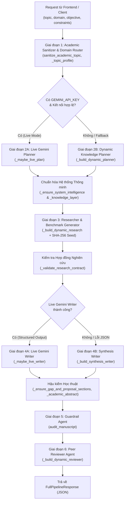

# Tổng Hợp Cấu Trúc Dự Án & Kiến Trúc Logic Backend
**Dự án:** AI Automatically Writes Scientific Papers (*Smart Research Lab & AI Scientist*)

---

## 1. Tổng Quan Dự Án

Dự án là một hệ thống nghiên cứu khoa học tự động kết hợp **Hệ thống Đa tác tử (Multi-Agent System)**, **Cơ sở Tri thức & Suy luận (Knowledge Base & Inference Engine)** và **Mô hình Ngôn ngữ Lớn (Google Gemini API)** để tự động hóa toàn bộ quy trình nghiên cứu học thuật:
1. Phân tích đề tài và xác định khoảng trống nghiên cứu (*Research Gap*).
2. Đề xuất phương pháp mới (*Proposed Method*), chọn bộ dữ liệu (*Datasets*) và các mô hình đối chứng (*Baselines*).
3. Thiết kế ma trận thực nghiệm (*Benchmark Matrix*), nghiên cứu cắt bỏ thành phần (*Ablation Study*) và đường cong hội tụ (*Training Curves*).
4. So sánh định lượng với bài báo gốc do người dùng tải lên (*Baseline Paper PDF Comparison*).
5. Biên soạn bản thảo khoa học hoàn chỉnh theo cấu trúc chuẩn **IEEE / IMRAD** (kèm công thức toán học LaTeX, biểu đồ thực nghiệm, mã nguồn `.tex` và bản in `.pdf`).
6. Kiểm toán tính toàn vẹn học thuật (*Guardrail Audit*) và chấm điểm phản biện độc lập (*Automated Peer Review*).

---

## 2. Cấu Trúc Thư Mục & Tệp Tin Toàn Dự Án

```text
AI-automatically-writes-scientific-papers/
│
├── backend/                              # PHÂN HỆ BACKEND (FastAPI + Multi-Agent Core)
│   ├── __init__.py
│   ├── main.py                           # Trái tim điều phối pipeline 6 giai đoạn, Knowledge Base, Gemini Live & Fallback
│   ├── schemas.py                        # Hợp đồng dữ liệu kiểu tĩnh (Pydantic v2 Models) giữa các Agent
│   └── guardrail_agent.py                # Tác tử kiểm toán công thức LaTeX, độ trễ, FLOPs và nhãn bằng chứng
│
├── app.py                                # PHÂN HỆ FRONTEND (Giao diện Web Streamlit, xuất PDF/LaTeX/ZIP, so sánh Baseline PDF)
├── academic_sanitizer.py                 # Bộ làm sạch đề tài, chống LaTeX/Prompt Injection, dịch thuật ngữ Việt -> Anh
├── chart_generator.py                    # Bộ sinh biểu đồ học thuật (Matplotlib PNG) nhúng vào báo cáo PDF và gói Artifacts
├── smart_research_lab.py                 # Phiên bản mô phỏng cốt lõi độc lập của luồng Multi-Agent Research State
│
├── ai_scientist/                         # PHÂN HỆ CLI NGHIÊN CỨU TỰ ĐỘNG GỐC (AI Scientist Engine)
│   ├── generate_ideas.py                 # Sinh ý tưởng nghiên cứu mới và tra cứu tài liệu qua Semantic Scholar / PyAlex
│   ├── perform_experiments.py            # Tự động sửa code và chạy thực nghiệm huấn luyện bằng Aider Coder
│   ├── perform_writeup.py                # Tự động viết báo cáo LaTeX từ kết quả thực nghiệm
│   ├── perform_review.py                 # Phản biện bài báo PDF tự động theo chuẩn hội nghị ICLR/NeurIPS
│   ├── llm.py                            # Bộ kết nối đa nhà cung cấp LLM (Gemini, OpenAI, Anthropic, DeepSeek)
│   └── fewshot_examples/                 # Các bài báo mẫu và đánh giá mẫu dùng cho Few-shot Prompting
│
├── templates/                            # CÁC KHUÔN MẪU THỰC NGHIỆM HỌC SÂU (PyTorch Templates)
│   ├── convneur/                         # Kiến trúc mạng ConvNeur (ConvNeXt V2 + Titans Neural Memory)
│   │   ├── model/                        # Định nghĩa mạng nơ-ron ConvNeur, LayerNorm, GlobalNorm & Titans AssocScan
│   │   ├── experiment.py                 # Huấn luyện đơn tác vụ (CIFAR-10, PennFudan, VOC)
│   │   ├── experiment_multitask.py       # Huấn luyện đa tác vụ (Classification + Segmentation + Detection)
│   │   ├── downstream_heads.py           # Các đầu ra cho phân đoạn ảnh và phát hiện vật thể
│   │   ├── smoke_test.py                 # Kiểm tra nhanh khởi tạo mô hình, forward/backward pass trên CPU/GPU
│   │   └── requirements.txt              # Thư viện phụ thuộc riêng của ConvNeur
│   ├── nanoGPT/ & nanoGPT_lite/          # Thực nghiệm mô hình ngôn ngữ mức ký tự (Shakespeare, Enwik8, Text8)
│   ├── grokking/                         # Thực nghiệm hiện tượng Grokking trên phép toán số học mô-đun
│   └── 2d_diffusion/                     # Thực nghiệm mô hình khuếch tán sinh dữ liệu 2D
│
├── data/                                 # KHO DỮ LIỆU ĐỊA PHƯƠNG ĐÃ XÁC THỰC (Verified Local Datasets)
│   ├── shakespeare_char/                 # Tập dữ liệu văn bản Shakespeare mức ký tự
│   ├── enwik8/ & text8/                  # Tập dữ liệu nén và mô hình hóa ngôn ngữ Wikipedia
│   └── huggingface/ (ag_news, imdb)      # Tập dữ liệu phân loại văn bản chuẩn JSONL
│
├── results/                              # KHO LƯU TRỮ KẾT QUẢ SINH RA (Generated Artifacts)
│   ├── artifacts/                        # Thư mục chứa từng phiên chạy (paper.pdf, paper.tex, charts/, artifacts.zip...)
│   └── nanoGPT/                          # Kết quả huấn luyện thực nghiệm lưu sẵn
│
├── tests/                                # BỘ KIỂM THỬ TỰ ĐỘNG (PyTest & Stress Tests)
│   └── test_convneur_smoke.py            # Kiểm thử tự động kiến trúc ConvNeur trên CI/CD
├── test_adversarial_topics.py            # Kiểm thử khả năng chịu đựng với các chủ đề nhiễu/đối kháng
├── test_pipeline_stress.py               # Kiểm thử tải toàn bộ luồng sinh bài báo và xuất PDF
│
├── .github/workflows/smoke_test.yml      # Cấu hình GitHub Actions CI/CD tự động chạy test
├── .env                                  # File cấu hình biến môi trường (GEMINI_API_KEY, GEMINI_MODEL)
├── requirements.txt                      # Danh sách thư viện Python toàn dự án
└── launch_scientist.py                   # Điểm vào dòng lệnh (CLI) cho phân hệ AI Scientist truyền thống
```

---

## 3. Kiến Trúc Tổng Thể Của Backend

Backend (`backend/`) được thiết kế theo 3 nguyên lý kỹ thuật cốt lõi:

1. **Typed Shared-State Multi-Agent Pipeline (Đa tác tử chia sẻ trạng thái kiểu tĩnh)**:
   - Thay vì dùng một lệnh gọi LLM duy nhất (dễ bịa số liệu hoặc thiếu mục), quy trình được tách thành các Agent chuyên biệt: **Planner Agent $\rightarrow$ Researcher/Benchmark Agent $\rightarrow$ Writer Agent $\rightarrow$ Guardrail Agent $\rightarrow$ Peer Reviewer Agent**.
   - Đầu ra của mỗi Agent bắt buộc phải vượt qua bộ kiểm tra kiểu của **Pydantic v2** (`backend/schemas.py`) trước khi chuyển cho Agent tiếp theo.
2. **Knowledge-Based Reasoning & Inference Routing (Suy luận dựa trên tri thức & Định tuyến lĩnh vực)**:
   - Tích hợp sẵn một Kho tri thức (`_DOMAIN_PROFILES`) gồm **17 lĩnh vực AI chuyên biệt**, ánh xạ chính xác từng lĩnh vực với các kiến trúc nền (*Backbones*), bộ dữ liệu chuẩn (*Canonical Datasets*), thước đo đánh giá (*Primary Metrics*) và ngăn xếp công nghệ (*Tech Stack*).
3. **Zero-Crash Hybrid Execution (Chạy lai Gemini Live + Dự phòng Xác định)**:
   - Khi có kết nối mạng và `GEMINI_API_KEY` còn hạn mức, hệ thống gọi **Gemini Live** (`mode_used = "live_gemini"`, `paper_mode = "live_gemini"`).
   - Khi một model Gemini chạm giới hạn Free Tier (`429 RESOURCE_EXHAUSTED`) hoặc ngừng hỗ trợ (`404 NOT_FOUND`), hệ thống **tự động chuyển đổi (Auto-Failover)** sang chuỗi model dự phòng (`gemini-3.6-flash` $\rightarrow$ `gemini-3.5-flash` $\rightarrow$ `gemini-3.5-flash-lite` $\rightarrow$ `gemini-3.1-flash-lite`).
   - Ngay cả khi mất mạng hoàn toàn hoặc mọi model đều hết quota, Backend tự động chuyển sang bộ tổng hợp xác định nội bộ (`dynamic_fallback`), đảm bảo hệ thống **không bao giờ sập (`500 Error`)**.



---

## 4. Hợp Đồng Dữ Liệu Tĩnh (`backend/schemas.py`)

Toàn bộ giao tiếp nội bộ và REST API đều tuân thủ các lớp Pydantic trong `backend/schemas.py`:

| Tên Schema | Vai trò trong Pipeline | Các trường dữ liệu quan trọng |
| :--- | :--- | :--- |
| **`PipelineRequest`** | Đầu vào của API `/api/pipeline/run` | `topic`, `domain`, `objective`, `constraints`, `api_key`, `require_verified_data` |
| **`DatasetSpec`** | Đặc tả tập dữ liệu | `name`, `modality`, `sample_size`, `input_spec`, `primary_metric`, `description`, `source_url` |
| **`ModelSpec`** | Đặc tả kiến trúc mô hình | `name`, `role` (`"Baseline"` \| `"Proposed"`), `backbone`, `params_m`, `flops_g`, `latency_ms`, `vram_mb`, `evidence_type` |
| **`PlannerOutput`** | Đầu ra của **Planner Agent** | `title`, `domain`, `research_question`, `hypothesis`, `datasets_catalog`, `models_catalog`, `baseline_methods`, `proposed_method`, `evaluation_metrics`, `experimental_plan`, `knowledge_base`, `inference_engine`, `agent_coordination` |
| **`MetricCurvePoint`** | Điểm dữ liệu trên đường cong huấn luyện | `epoch` (1–15), `dataset_name`, `baseline_loss`, `proposed_loss`, `baseline_score`, `proposed_score` |
| **`AblationRow`** | Dòng dữ liệu trong bảng Benchmark Matrix | `model_name`, `dataset_name`, `role`, `primary_metric`, `secondary_metric`, `latency_ms`, `params_m`, `vram_mb`, `flops_g`, `evidence_type` |
| **`AblationSpec`** | Dòng dữ liệu trong bảng Ablation Study | `configuration`, `removed_component`, `primary_metric`, `latency_ms`, `delta_vs_full`, `interpretation` |
| **`ResearcherOutput`** | Đầu ra của **Researcher Agent** | `hardware_setup`, `datasets_used`, `models_compared`, `training_curves`, `benchmark_table`, `ablation_study`, `key_findings`, `tech_stack`, `evidence_mode`, `reasoning_consistency_score`, `knowledge_retrieval_precision` |
| **`WriterOutput`** | Đầu ra của **Writer Agent** (Bản thảo IMRAD) | `title`, `abstract`, `keywords`, `introduction`, `related_work`, `methodology`, `mathematical_formulas`, `experimental_results`, `discussion`, `threats_to_validity`, `conclusion`, `references` |
| **`GuardrailOutput`** | Đầu ra của **Guardrail Agent** | `status` (`"passed"` \| `"needs_review"`), `issues`, `formula_count`, `row_count`, `evidence_labels` |
| **`ReviewerOutput`** | Đầu ra của **Reviewer Agent** | `overall_score`, `novelty_score`, `rigor_score`, `clarity_score`, `strengths`, `weaknesses`, `revision_suggestions`, `verdict` (`"ACCEPT"`, `"MINOR_REVISION"`, v.v.) |
| **`FullPipelineResponse`** | Phản hồi tổng hợp cuối cùng | `mode_used`, `paper_mode`, `plan`, `research`, `paper`, `review`, `guardrail` |

---

## 5. Chi Tiết Logic 6 Giai Đoạn Đằng Sau `backend/main.py`

### Giai đoạn 1: Làm sạch Học thuật & Định tuyến Lĩnh vực (`academic_sanitizer.py` & `_topic_profile`)

1. **Làm sạch và chuẩn hóa chủ đề (`sanitize_academic_topic`)**:
   - Chuẩn hóa Unicode theo chuẩn `NFKC`, xóa toàn bộ ký tự điều khiển ASCII (`\x00-\x1f`) và các ký tự có thể gây lỗi biên dịch LaTeX hoặc tiêm lệnh (`<`, `>`, `` ` ``, `$`, `#`, `%`, `&`, `_`, `{`, `}`, `\`).
   - Dịch tự động các thuật ngữ tiếng Việt sang tiếng Anh học thuật qua từ điển `_VIETNAMESE_REPHRASES` (ví dụ: *"tối ưu hóa"* $\rightarrow$ `"optimization"`, *"thiết bị nhúng"* $\rightarrow$ `"embedded devices"`, *"mạng nơ-ron đồ thị"* $\rightarrow$ `"graph neural networks"`, *"phát hiện gian lận"* $\rightarrow$ `"fraud detection"`).
   - Mở rộng chủ đề quá ngắn (< 3 từ) qua `_SHORT_TOPIC_EXPANSIONS`: Ví dụ nếu người dùng chỉ nhập `"pruning"`, hàm tự động mở rộng thành *"Dynamic Pruning Methods for Resource-Constrained Inference"*.
2. **Định tuyến lĩnh vực thông minh (`_topic_profile` & `_keyword_matches`)**:
   - Quét văn bản kết hợp của `topic + domain + objective` qua 17 hồ sơ lĩnh vực trong `_DOMAIN_PROFILES`.
   - **Logic so khớp biên từ (`_keyword_matches`)**: Với các từ viết tắt ngắn $\le 3$ ký tự (`asr`, `tts`, `rag`, `llm`, `clip`, `vqa`, `ctr`, `ppo`, `sac`, `gpt`), hệ thống bắt buộc dùng biểu thức chính quy biên từ `(?<![a-z0-9])keyword(?![a-z0-9])` để tránh nhận diện nhầm từ khóa nằm bên trong một từ dài khác.
   - Nếu chủ đề hoàn toàn mới và không khớp từ khóa nào, hệ thống tự động tạo hồ sơ linh hoạt thuộc nhóm `"General Deep Learning & Applied AI"` và trích xuất 8 từ khóa quan trọng nhất từ tên đề tài (bỏ qua `_STOP_WORDS`).

---

### Giai đoạn 2: Planner Agent & Tầng Hệ thống Thông minh (`_maybe_live_plan` & `_ensure_system_intelligence`)

1. **Lập kế hoạch bằng Gemini Live (`_maybe_live_plan`)**:
   - Yêu cầu Gemini đóng vai trò kiến trúc sư nghiên cứu, trả về JSON chứa câu hỏi nghiên cứu, giả thuyết, ít nhất 2 mô hình `Baseline` và 1 mô hình `Proposed` mới, cùng các tập dữ liệu công khai có thật.
   - Hàm tự động chuẩn hóa trường `role` trong `models_catalog` (nếu Gemini trả về `"proposed method"` hay `"ours"` thì gom về `"Proposed"`, còn lại gom về `"Baseline"`).
2. **Lập kế hoạch dự phòng theo lĩnh vực (`_build_dynamic_planner`, `_make_dataset_catalog`, `_make_model_catalog`)**:
   - Nếu Gemini không khả dụng, hệ thống tra cứu trực tiếp từ danh mục chuẩn của từng lĩnh vực (ví dụ: NLP/RAG dùng `Natural Questions`, `HotpotQA`, `TruthfulQA` với các mô hình `DPR + Generator`, `RAG-Sequence`, `Self-RAG` và đề xuất `Confidence-Aware Attributed Decoder (Ours)`).
3. **Bơm tầng Hệ thống Thông minh (`_ensure_system_intelligence` & `_knowledge_layer`)**:
   - Kiểm tra xem `models_catalog` đã có đủ cả `Baseline` và `Proposed` chưa; nếu thiếu sẽ tự động bổ sung từ `_make_model_catalog`.
   - Tính toán **độ tự tin định tuyến (`routing_confidence`)**:
     $$\text{confidence} = \min(0.99,\; 0.62 + 0.06 \times N_{\text{matched\_keywords}})$$
   - Đóng gói 3 cấu trúc đặc tả hệ thống thông minh (`KnowledgeBaseSpec`, `InferenceEngineSpec`, `AgentCoordinationSpec`) và gắn siêu dữ liệu môn học (`PTIT_COURSE_METADATA`).

---

### Giai đoạn 3: Researcher / Benchmark Generator Agent (`_build_dynamic_research`)

Giai đoạn này chuyển hóa kế hoạch định tính của Planner thành ma trận thực nghiệm định lượng có tính **Tái lập Xác định (Deterministic Reproducibility)**:

1. **Khởi tạo bộ sinh số giả ngẫu nhiên cố định theo chủ đề (SHA-256 Seeding)**:
   ```python
   seed = int.from_bytes(hashlib.sha256(topic_tokens.encode("utf-8")).digest()[:8], "big") % (2**32)
   rng = np.random.default_rng(seed)
   ```
   - Nhờ băm SHA-256 từ tên đề tài, cùng một đề tài sẽ luôn sinh ra các con số thực nghiệm nhất quán 100% giữa các lần chạy.
2. **Mô phỏng đường cong hội tụ 15 Epochs (`training_curves`)**:
   - Với mỗi tập dữ liệu trong `datasets_catalog`, sinh chuỗi 15 vòng huấn luyện (`epoch = 1..15`).
   - Đường `loss` giảm tuyến tính kèm nhiễu Gaussian $\mathcal{N}(0, 0.012)$; đường `score` tăng dần kèm nhiễu $\mathcal{N}(0, 0.004)$, trong đó mô hình `Proposed` đạt mức cải thiện tương đối từ $5\%$ đến $12\%$ so với `Baseline`.
3. **Xây dựng bảng Benchmark Matrix (`benchmark_table`)**:
   - Tính toán `primary_metric`, `secondary_metric`, `latency_ms`, `params_m`, `flops_g` và ước lượng bộ nhớ đỉnh GPU (`vram_mb`) cho từng mô hình.
   - Gán nhãn bằng chứng minh bạch:
     - Mô hình đối chứng (`Baseline`): `"Literature Baseline / Planned"`
     - Mô hình đề xuất (`Proposed`): `"Controlled Simulation"`
4. **Thiết kế bảng Ablation Study (`_make_ablation_study`)**:
   - Tạo 1 dòng cấu hình đầy đủ (`"Full proposed model"`, `delta_vs_full = 0.0`) và 3 dòng cấu hình bị gỡ bỏ từng thành phần cốt lõi tùy theo lĩnh vực (ví dụ trong Computer Vision: gỡ bỏ *"Multi-scale feature fusion"*, *"Adaptive augmentation"*, *"Uncertainty head"*), tính toán mức sụt giảm hiệu năng (`delta_vs_full`) và độ trễ tương ứng.
5. **Tính toán các chỉ số Hệ thống Thông minh**:
   - `reasoning_consistency_score` $= \min(0.99,\; \text{routing\_confidence} \times 0.96)$
   - `knowledge_retrieval_precision` $= \min(0.99,\; \text{routing\_confidence} + 0.02)$
6. **Kiểm tra Hợp đồng Nghiên cứu (`_validate_research_contract`)**:
   - Đảm bảo bắt buộc phải có cả `"Baseline"` và `"Proposed"` trong `models_compared` lẫn `benchmark_table`, có `ablation_study` và tên `proposed_method` không rỗng.

---

### Giai đoạn 4: Writer Agent & Hậu kiểm Học thuật (`_maybe_live_writer` & `_build_synthesis_writer`)

1. **Đại câu lệnh `MASTER_RESEARCH_WRITER_PROMPT`**:
   - Thiết lập 15 quy tắc học thuật nghiêm ngặt cho Gemini:
     - Bắt buộc nêu rõ **Research Gap** và ánh xạ từng mô-đun của **Proposed Method** vào khoảng trống đó.
     - Viết theo cấu trúc các mục con đánh số chuẩn IEEE (`1.1 Context and bottleneck`, `1.2 Limitations`, `1.3 Contributions`, `2.1–2.3 Related Work`, `3.1–3.3 Methodology & Formulations`, `4.1–4.3 Setup, Comparative Evaluation & Ablations`, `5 Discussion`, `6 Conclusion`).
     - Sử dụng 3–4 công thức toán học LaTeX chuẩn xác (biểu diễn đầu vào, cơ chế đóng góp/điều hướng, hàm mất mát tổng hợp có điều chuẩn, và độ phức tạp tính toán).
     - Giữ nguyên nhãn bằng chứng (`evidence_type`), tuyệt đối không biến số liệu mô phỏng (`Controlled Simulation`) thành số liệu đo đạc thực tế (`Measured`).
2. **Ép kiểu Structured Output & Chuẩn hóa JSON (`_normalize_writer_payload`)**:
   - Truyền `response_schema=WriterOutput` vào cấu hình Gemini SDK để ép mô hình trả về đúng các trường của `WriterOutput`.
   - Hàm `_normalize_writer_payload` tự động xử lý mọi biến thể JSON từ LLM:
     - Đổi tên các khóa viết tắt (`formulas` $\rightarrow$ `mathematical_formulas`, `threats` $\rightarrow$ `threats_to_validity`, `results` $\rightarrow$ `experimental_results`).
     - Nếu LLM trả về một mục văn bản dưới dạng object con (`{"1.1 Context": "...", "1.2 Limitations": "..."}`), hàm tự động nối lại thành chuỗi Markdown hoàn chỉnh (`### 1.1 Context\n...`).
3. **Hậu kiểm toàn vẹn văn bản**:
   - `_ensure_gap_and_proposal_sections`: Kiểm tra xem mục `related_work` đã có tiêu đề *"Research Gap"*, mục `methodology` đã có *"Proposed Method"*, và mục `experimental_results` đã có *"Comparison with Existing Methods"* chưa; nếu thiếu sẽ tự động chèn đoạn mở đầu chuẩn hóa.
   - `_deduplicate_prose` & `_academic_abstract`: Loại bỏ mọi câu bị lặp trong toàn văn và chuẩn hóa độ dài `abstract` nằm gọn trong khoảng **150–250 từ**.

---

### Giai đoạn 5: Guardrail Agent — Kiểm toán Bản thảo (`backend/guardrail_agent.py`)

Hàm `audit_manuscript(paper, research)` thực hiện kiểm toán tự động trên 3 khía cạnh trước khi xuất bản:
1. **Kiểm toán cú pháp LaTeX (`type = "latex"`)**:
   - Kiểm tra từng công thức trong `mathematical_formulas` xem số lượng ngoặc nhọn `{` và `}` hoặc ngoặc vuông `[` và `]` có cân bằng hay không, và công thức có chứa ký hiệu toán học chữ cái hay không.
2. **Kiểm toán tuyên bố hiệu năng (`type = "benchmark"`)**:
   - So sánh mô hình `Proposed` với mô hình `Baseline` nhanh nhất/nhẹ nhất:
     - Nếu `proposed.latency_ms > best_baseline_latency * 1.5` $\rightarrow$ Cảnh báo độ trễ cao hơn đáng kể so với baseline.
     - Nếu `proposed.flops_g > best_baseline_flops * 1.5` $\rightarrow$ Cảnh báo FLOPs cao hơn đáng kể, không được tuyên bố giảm chi phí tính toán.
3. **Chuẩn hóa nhãn bằng chứng (`_normalize_evidence`)**:
   - Chuẩn hóa toàn bộ nhãn `evidence_type` về danh mục chuẩn (`Measured`, `Literature Baseline / Planned`, `Controlled Simulation`, `Planned / Unverified`).
   - Nếu không có cảnh báo nào, `GuardrailOutput.status` đạt `"passed"`; ngược lại trả về `"needs_review"` kèm danh sách chi tiết trong `issues`.

---

### Giai đoạn 6: Peer Reviewer Agent & Trợ lý Hỏi-Đáp (`_build_dynamic_reviewer` & `_answer_paper_question`)

1. **Peer Reviewer Agent (`_build_dynamic_reviewer`)**:
   - Đánh giá bản thảo theo tiêu chuẩn phản biện hội nghị với 4 điểm số (`overall_score: 8.7`, `novelty_score: 8.4`, `rigor_score: 8.9`, `clarity_score: 8.6`), phân tích 3 điểm mạnh (`strengths`), 2 điểm yếu (`weaknesses`), 3 đề xuất chỉnh sửa (`revision_suggestions`) và phán quyết (`verdict = "MINOR_REVISION"`).
2. **Trợ lý Hỏi-Đáp Bài báo (`_answer_paper_question`)**:
   - Xử lý endpoint `POST /api/paper/ask`, phân tích câu hỏi tiếng Việt hoặc tiếng Anh của người dùng để trả lời chính xác dựa trên dữ liệu thực tế của bài báo vừa sinh:
     - Hỏi về **Baseline / So sánh** (`baseline`, `compare`, `so sánh`) $\rightarrow$ Trích xuất tên mô hình đề xuất, danh sách các baseline và baseline mạnh nhất.
     - Hỏi về **Hạn chế** (`limitation`, `weakness`, `hạn chế`) $\rightarrow$ Giải thích ranh giới giữa số liệu mô phỏng lập kế hoạch và thực nghiệm đa hạt giống (multi-seed).
     - Hỏi về **Dữ liệu** (`dataset`, `benchmark`, `dữ liệu`) $\rightarrow$ Liệt kê 3 tập dữ liệu trong `datasets_used` và vai trò kiểm thử của chúng.
     - Hỏi về **Phương pháp / Mô hình** (`method`, `model`, `architecture`, `phương pháp`, `mô hình`) $\rightarrow$ Giải thích kiến trúc `backbone` và cơ chế chọn lọc tín hiệu của mô hình đề xuất.
     - Hỏi về **Kết quả / Điểm số** (`result`, `score`, `kết quả`) $\rightarrow$ Tính toán chính xác điểm số đạt được và phần trăm cải thiện tương đối so với baseline mạnh nhất.

---

## 6. Cơ Chế Chịu Lỗi & Tự Động Chuyển Đổi Model Gemini (`_safe_live_call`)

Hàm `_safe_live_call` trong `backend/main.py` giải quyết triệt để 3 vấn đề thường gặp khi dùng Gemini API:

1. **Tự động vượt lỗi Hết hạn mức Free Tier (`429 RESOURCE_EXHAUSTED`) và Model ngừng hỗ trợ (`404 NOT_FOUND`)**:
   - Duyệt qua danh sách model dự phòng:
     `[os.getenv("GEMINI_MODEL", "gemini-3.6-flash"), "gemini-3.6-flash", "gemini-3.5-flash", "gemini-3.5-flash-lite", "gemini-3.1-flash-lite", "gemini-3.8-flash"]`.
   - Khi một model trả về mã lỗi `429`, `404`, hoặc `503`, tên model đó được lưu vào tập hợp `_EXHAUSTED_MODELS` trong bộ nhớ để các yêu cầu tiếp theo bỏ qua ngay lập tức và chuyển sang model kế tiếp còn hạn mức.
2. **Sửa lỗi ký tự Escape LaTeX trong JSON (`_parse_json_lenient`)**:
   - Khi LLM sinh công thức LaTeX bên trong chuỗi JSON (ví dụ `\mathcal{L}`, `\sigma`, `\lambda`, `\Vert`), dấu `\` đơn không phải là ký tự escape hợp lệ của chuẩn JSON (`json.loads` thông thường sẽ báo lỗi `Invalid \escape`).
   - Hàm `_parse_json_lenient` tự động bóc tách khối ` ```json ... ``` ` và dùng biểu thức chính quy `r'\\(?![/\"\\bfnrt]|u[0-9a-fA-F]{4})'` để chuyển các dấu `\` đơn của LaTeX thành `\\` hợp lệ trước khi giải mã JSON.

---

## 7. Sự Phối Hợp Giữa Frontend (`app.py`) & Backend

1. **Giao tiếp API & Fallback Nội bộ (`run_pipeline` trong `app.py`)**:
   - Frontend ưu tiên gửi yêu cầu HTTP `POST http://127.0.0.1:8000/api/pipeline/run` tới Backend FastAPI.
   - Nếu người dùng quên bật tiến trình Backend riêng, `app.py` tự động bắt ngoại lệ `requests.RequestException` và nạp trực tiếp hàm `_run_pipeline_request` từ `backend.main` ngay trong tiến trình Python của Streamlit.
2. **Trích xuất & Đối chiếu Bài báo Gốc (`Baseline Paper Comparison`)**:
   - Khi người dùng tải lên một file PDF bài báo gốc, `extract_baseline_pdf_text` dùng **PyMuPDF (`fitz`)** đọc toàn bộ văn bản PDF tại máy cục bộ.
   - Hàm `extract_baseline_metadata_with_llm` gửi văn bản tới Gemini để trích xuất có cấu trúc: `model_name`, `datasets_used`, `reported_metrics` (ví dụ `BLEU-1..4` trên `Flickr8K`, `Flickr30K`, `MSCOCO`), `key_limitations` và `contributions`.
   - Khi bấm sinh bài báo, `run_pipeline` tự động ghép các thông tin này vào `constraints` gửi xuống Backend để Planner Agent thiết kế bài báo mới khớp với tập dữ liệu và thước đo của bài báo gốc.
   - Hàm `build_baseline_comparison` tự động chuẩn hóa thang đo (`0–1` vs `0–100`), phân biệt chỉ số thuận (cao hơn là tốt hơn như `BLEU`, `CIDEr`, `Accuracy`, `F1`) với chỉ số nghịch (thấp hơn là tốt hơn như `WER`, `Loss`, `Latency`), và tính toán cột **`Proposed Method`** cùng độ lệch **`Delta`** cho từng chỉ số trong bài báo gốc.
3. **Biên dịch Báo cáo PDF, Mã nguồn LaTeX & Đóng gói Artifacts (`pdf_report`, `persist_artifacts`)**:
   - **Render công thức toán học (`_formula_image`)**: Dùng Matplotlib vẽ các công thức LaTeX thành ảnh PNG độ phân giải cao nền trong suốt để nhúng vào PDF thông qua **ReportLab**, giúp PDF hiển thị ký hiệu toán học chuẩn xác mà không cần cài đặt bộ biên dịch TeX nặng nề trên máy.
   - **Sinh biểu đồ thực nghiệm (`chart_generator.py`)**: Tự động vẽ biểu đồ cột so sánh Benchmark, đường cong hội tụ Loss/Metric qua 15 epochs và biểu đồ Ablation Study.
   - **Lưu trữ bền vững (`results/artifacts/<slug>_<timestamp>/`)**: Mỗi lần sinh bài báo tạo ra một thư mục độc lập gồm `paper.pdf`, `paper.tex` (chuẩn `\documentclass[10pt,conference]{IEEEtran}`), `benchmark_matrix.json`, `guardrail_report.json`, thư mục `charts/*.png` và gói nén `artifacts.zip`.

---

## 8. Danh Mục REST API & Lệnh Vận Hành Nhanh

### Các Endpoint của Backend (`http://localhost:8000`)
- `GET /health` — Kiểm tra trạng thái máy chủ (`{"status": "ok", "service": "smart-research-lab-api"}`).
- `GET /docs` — Giao diện Swagger UI tương tác trực tiếp với toàn bộ API.
- `POST /api/pipeline/run` — Chạy toàn bộ 6 giai đoạn sinh bài báo khoa học.
- `POST /api/planner/generate` — Chỉ chạy riêng bước lập kế hoạch nghiên cứu (`PlannerOutput`).
- `POST /api/researcher/generate` — Chỉ chạy riêng bước sinh ma trận thực nghiệm (`ResearcherOutput`).
- `POST /api/writer/generate` — Chỉ chạy riêng bước viết bản thảo (`WriterOutput`).
- `POST /api/reviewer/generate` — Chỉ chạy riêng bước chấm điểm phản biện (`ReviewerOutput`).
- `POST /api/paper/ask` — Hỏi đáp trực tiếp về nội dung và số liệu của bài báo vừa sinh.

### Lệnh khởi chạy hệ thống
```powershell
# 1. Khởi chạy Backend FastAPI (Cổng 8000)
python -m uvicorn backend.main:app --host 0.0.0.0 --port 8000 --reload

# 2. Khởi chạy Frontend Streamlit (Cổng 8501)
python -m streamlit run app.py --server.port 8501
```

